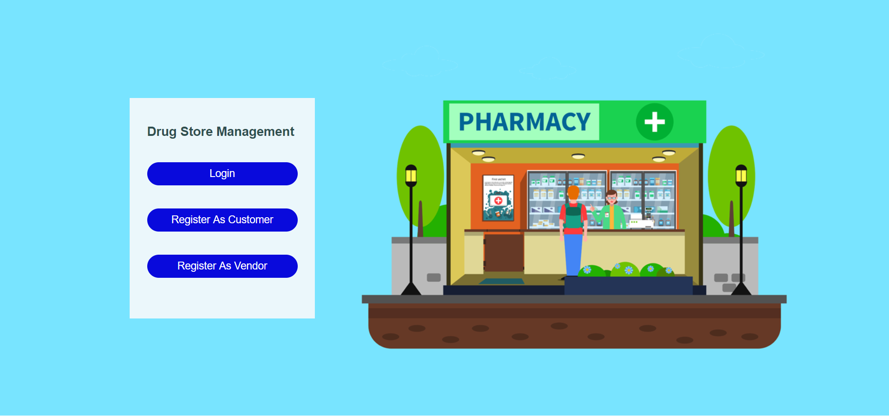
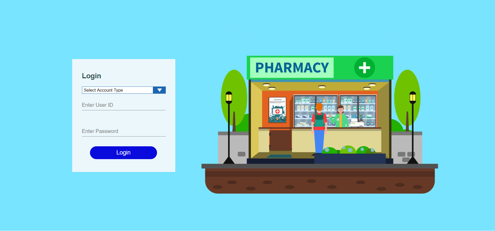
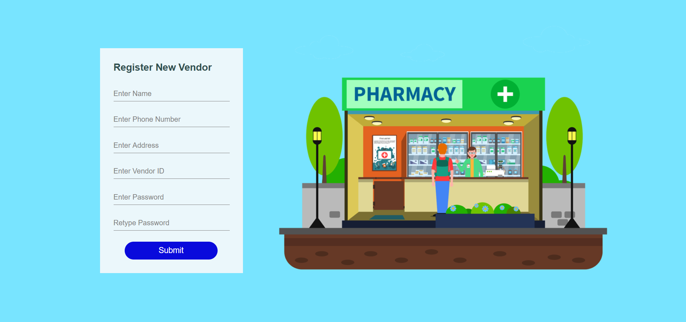
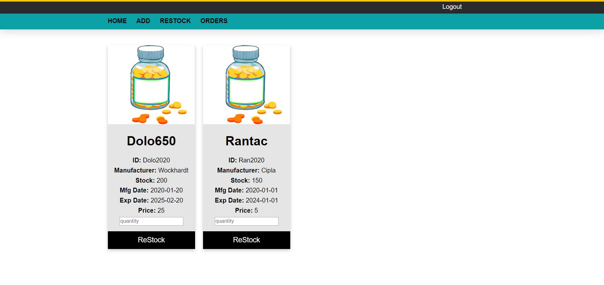
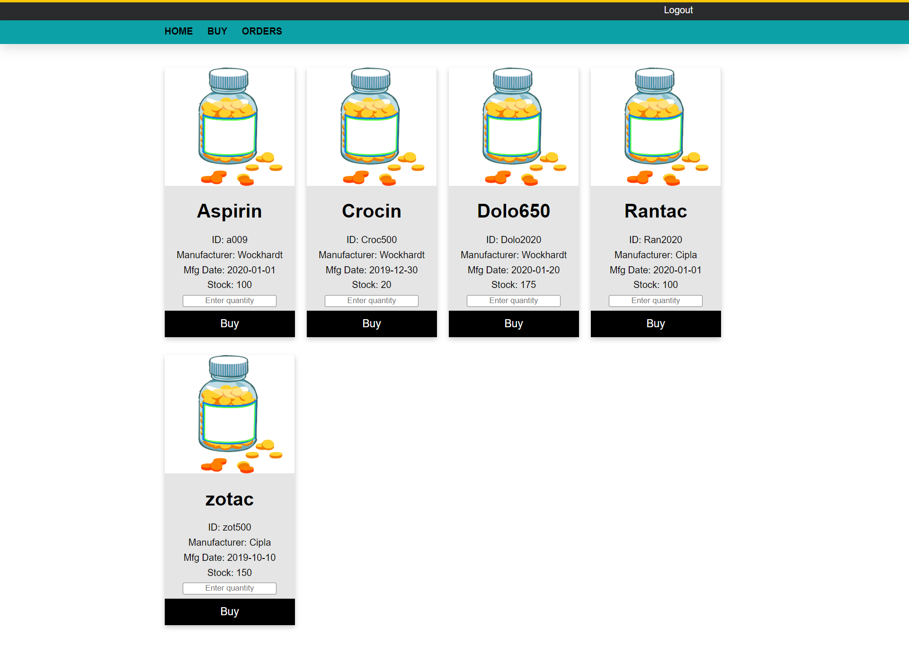
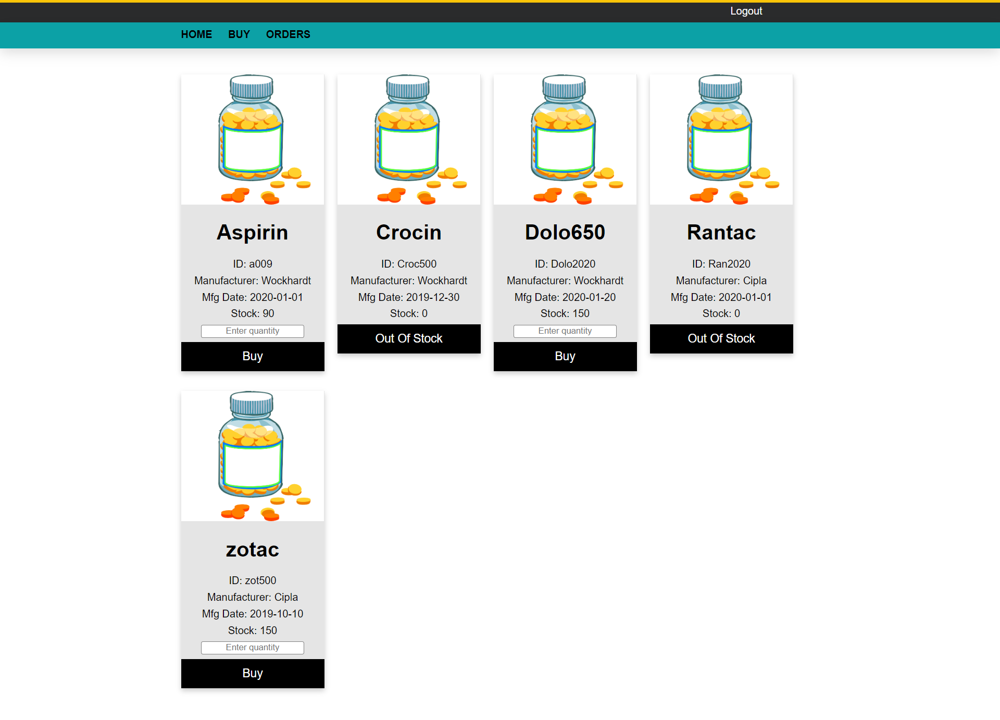

# Pharmacy Drug Management System

A web application that connects pharmacy **vendors** and **customers**. Vendors list drugs and manage their stock; customers browse what is available and place orders. Built with Java Server Pages (JSP), JDBC and MySQL.

## Features

**Customers**
- Register and log in
- Browse every available drug with manufacturer, manufacturing date, price and live stock level
- Place orders (quantity is validated against available stock)
- View their order history with timestamps

**Vendors**
- Register and log in
- Add new drugs with manufacturer, manufacture/expiry dates, price and opening stock
- Restock existing products
- View all orders received from customers

**Behind the scenes**
- MySQL **triggers** timestamp each order and automatically reduce stock when an order is placed
- MySQL **stored procedures** fetch the order lists for customers and sellers
- Role-based access: customer pages and vendor pages are only available to the matching logged-in role
- All database access uses prepared statements, and all database values are HTML-escaped before display

## Tech stack

| Layer      | Technology                         |
|------------|------------------------------------|
| Frontend   | HTML, CSS, JSP                     |
| Backend    | Java, JSP, JDBC                    |
| Database   | MySQL (triggers + stored procedures) |
| Build      | Maven (WAR packaging)              |
| Server     | Apache Tomcat 7 - 9                |

## Screenshots

| Home | Login |
|------|-------|
|  |  |

| Vendor registration | Restock (vendor) |
|---------------------|------------------|
|  |  |

| Buy (customer) | Buy (customer) |
|----------------|----------------|
|  |  |

## Getting started

### Prerequisites
- JDK 8 or newer
- Maven 3.x
- MySQL 5.7 or 8.x
- Apache Tomcat 7, 8.5 or 9

### 1. Create the database
```bash
mysql -u root -p < database/schema.sql
```
This creates the `drugdatabase` schema with its tables, triggers and stored procedures.

### 2. Configure the database connection
The app reads its connection settings from JVM system properties or environment variables, so no credentials are stored in the code.

| Setting       | Default                                      |
|---------------|----------------------------------------------|
| `DB_URL`      | `jdbc:mysql://localhost:3306/drugdatabase`   |
| `DB_USER`     | `root`                                       |
| `DB_PASSWORD` | *(empty)*                                    |

The easiest way with Tomcat is a `bin/setenv.sh` (or `setenv.bat` on Windows) file:
```bash
export CATALINA_OPTS="-DDB_USER=root -DDB_PASSWORD=your_password"
```

### 3. Build and deploy
```bash
mvn clean package
```
Copy `target/pharmacy-drug-management.war` into Tomcat's `webapps/` folder and start Tomcat, then open:

```
http://localhost:8080/pharmacy-drug-management/
```

### 4. Try it out
1. Register as a **vendor** and log in
2. Add a product (**ADD**) - dates use the format `YYYY-MM-DD`
3. Log out, register as a **customer** and log in
4. Go to **BUY**, order the product, and check **ORDERS**
5. Log back in as the vendor to see the order under **ORDERS** and the reduced stock under **RESTOCK**

## Project structure

```
.
├── database/
│   └── schema.sql              # tables, triggers, stored procedures
├── docs/screenshots/           # images used in this README
├── src/main/webapp/
│   ├── *.jsp, *.html           # pages
│   ├── css/, images/           # static assets
│   └── WEB-INF/
│       ├── web.xml
│       └── jspf/               # shared includes: DB connection, HTML escaping, role checks
└── pom.xml
```

## Known limitations and ideas for improvement

- Passwords are stored in plain text - they should be hashed (e.g. BCrypt) before real use
- Forms have no CSRF protection
- Business logic lives in the JSP pages; moving it into servlets and DAO classes (MVC) would make it easier to test and extend
- Orders contain a single product each; a shopping cart would be a natural next step
